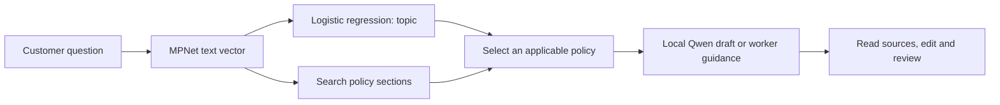
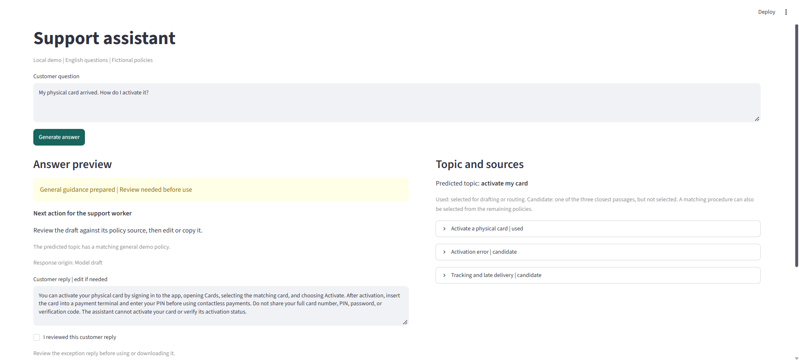
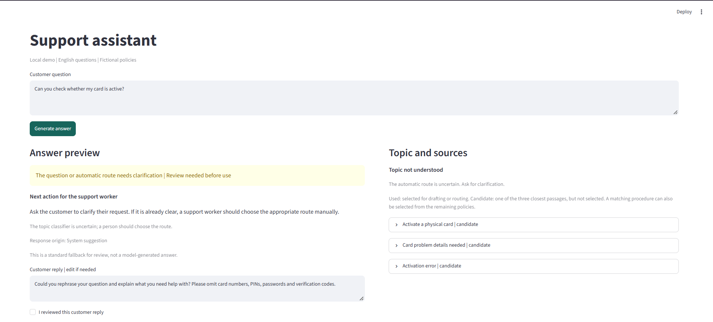

# Financial Support Assistant

## Overview

A local tool that helps a support worker answer English card-related questions.
It identifies the topic, finds a relevant fictional policy and prepares an
editable reply with its source. The worker checks the reply before using it;
nothing is sent automatically.

## How it works



- **MPNet** is a pretrained encoder: it converts questions and policy sections
  into vectors. Cosine similarity ranks the ten policy sections.
- **Logistic regression** was trained on 10,003 BANKING77 questions to predict
  one of 77 topics. It does not learn the policies or generate answers.
- **Python rules** map six relevant topics to the five supplied card policies
  and select a section using the question's details. Clear procedure rules can
  also handle an uncertain topic; other uncertain requests require worker review.
- **Qwen3-1.7B**, running through Ollama, drafts from the selected text.
  Source and known omission checks can reject a draft; the worker then sees
  the policy text instead. Requests for inaccessible records or unsupported
  topics receive worker guidance without a model call.

Only logistic regression was trained here; MPNet and Qwen remain pretrained.
The supported policies cover delivery, activation, damage and shop/online payment
problems. Recognizing a topic does not mean a policy exists for it.

## Results

| Classifier | Accuracy | Macro-F1 | Top-3 accuracy |
|---|---:|---:|---:|
| MiniLM + logistic regression (earlier comparison) | 93.18% | 0.9317 | 98.25% |
| MPNet + logistic regression (included model) | **93.83%** | **0.9384** | **98.67%** |

These scores measure intent labels on 3,080 previously inspected BANKING77 test
questions, not reply quality. `C=30` was selected using three-fold training-only
cross-validation; review thresholds used an 8,002/2,001 training split. The app
requests review below 0.5 confidence, which is not a guarantee of detecting
unfamiliar questions. Historical encoding used batches of 16; quantized vectors
can vary with batching, so these scores do not establish identical accuracy for
the app's single-question path.

Development checks found the expected route in 30/30 initial and 11/12 additional
questions; the remaining question safely required clarification. Drafts passed
the automated checks in 12/18 and 3/9 generation attempts respectively. These
small sets informed development and were rerun; they are not an untouched holdout.
Passing checks does not establish factual correctness. Every reply needs review.

## Demo

The activation example shows a model draft and its selected policy:



[Expanded activation source](assets/screenshots/card-activation-sources.png).

The short account-status question below requires clarification in this run;
the app does not claim to have checked a customer's account:



[Expanded candidate sources](assets/screenshots/routing-review-sources.png).

## Project layout

```text
streamlit_app.py       Local interface
src/                   Encoding, classification, retrieval and reply handling
scripts/               Encoder download and optional classifier training
configs/               Encoder and local Qwen settings
artifacts/             Included classifier weights and topic labels
knowledge_base/        Five fictional policies, ten searchable sections
assets/screenshots/    Interface examples
requirements.txt      Python dependencies
```

`artifacts/intent.npz` contains the trained weights; `intent.json` supplies their
ordered labels and review threshold. Both are required by the app. Encoder
settings identify the matching pretrained model. Downloads, caches and optional
training outputs stay local in `models/`, `data/`, `.cache/` and `reports/`.

## Setup and usage

Install Python 3.12 and [Ollama](https://docs.ollama.com/windows).
From the repository root, open two **PowerShell** terminals.

In the first terminal, start the local model server and leave it running:

```powershell
$env:OLLAMA_HOST = '127.0.0.1:11435'
$env:OLLAMA_MODELS = "$PWD\models\ollama"
ollama serve
```

This app uses port 11435; Ollama's usual desktop server uses 11434.
See [Ollama's server settings](https://docs.ollama.com/faq).
If 11435 is already running, keep that server and skip starting another one.

In the second terminal, install the dependencies and models, then start the app:

```powershell
python -m venv .venv
.\.venv\Scripts\python.exe -m pip install -r requirements.txt
.\.venv\Scripts\python.exe -m scripts.setup_embedding
$env:OLLAMA_HOST = '127.0.0.1:11435'
ollama pull qwen3:1.7b
.\.venv\Scripts\python.exe -m streamlit run streamlit_app.py
```

Open **http://127.0.0.1:8501**. Initial downloads need internet; inference then
runs locally. Later runs only need the server and the final Streamlit command.
Stop each terminal's running server with `Ctrl+C`.

The policies and classifier are included; no customer data is needed. Try:

| Question | Expected behavior |
|---|---|
| `My physical card arrived. How do I activate it?` | Activation guidance with its policy. |
| `How do I check my card shipment status in the app?` | General delivery instructions, without claiming access to a shipment. |
| `My card is not working. What details do you need?` | Ask for the missing payment context. |
| `Can you check whether my card is active?` | May require topic clarification; never confirms account status. |
| `What is the replacement fee for a damaged card?` | Refer to support rather than invent a price. |

Click **Generate answer**, expand a source marked **used**, and check the reply.
Sources marked **candidate** are search suggestions. Edit the reply if needed,
then check **I reviewed this customer reply** to enable the optional download.
Editing resets that acknowledgment. If generation fails, **Policy reference**
shows the selected source for worker editing. Wording and generation results vary.

Optional: `python -m scripts.train_intent` using the virtual environment's Python
downloads BANKING77, selects classifier settings and saves a separate candidate
under `models/retrained-intent/`. Its local report is `reports/retrained_intent.json`;
the included model is not overwritten.

## Limitations and sources

This is a local drafting prototype with fictional policies, not a bank service.
It cannot access accounts, activate cards or inspect payments. Small-model drafts
can omit conditions or invent details; the checks catch known patterns, not every
error. Use fictional English questions without personal information.

Data: [BANKING77 / PolyAI](https://github.com/PolyAI-LDN/task-specific-datasets),
CC-BY-4.0. Models: [MPNet](https://huggingface.co/sentence-transformers/all-mpnet-base-v2)
and [Qwen3-1.7B](https://huggingface.co/Qwen/Qwen3-1.7B), Apache-2.0.
