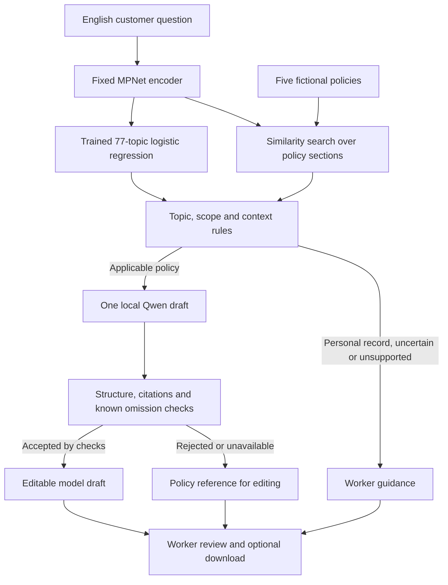

# Financial Support Assistant

## Overview

A local assistant for a support worker. It classifies an English customer question,
retrieves fictional card policies, and drafts an editable answer with sources.
A Streamlit interface keeps the customer reply, policy references and worker action
separate. Every reply requires worker review; nothing is sent automatically.

## Scope and limitations

- The classifier recognizes 77 BANKING77 topics. Five supplied policies cover
  physical-card delivery, activation, damage and selected payment problems.
- Policies are fictional. The app has no account, shipment or transaction access.
- MPNet and Qwen are pretrained; only logistic regression was trained here.
- This is a local drafting prototype, not a live bank service. It has no public
  hosting or FastAPI endpoint. Use English fictional questions without personal data.
- Small-model drafts can omit conditions, repeat supplied information or invent
  context. Automated checks catch known patterns, not every factual error.

## Architecture and workflow



The same normalized 768-dimensional question vector serves classification and
retrieval. All ten policy sections are ranked; explicit rules select the relevant
procedure and distinguish missing customer context from inaccessible records.
The panel shows the three closest passages plus the selected procedure if needed.

The model writes only `draft` and `source_ids`. The application owns the route,
status and missing-information fields. A maximum of one generation call is made.
Personal-record, unsupported and uncertain requests make no generation call.
A rejected draft is labeled **Policy reference**, using actual source text;
fixed record/scope messages are labeled **System suggestion**. Neither counts as
successful model generation. All replies remain visible and editable, but download
requires the review checkbox. Editing resets the acknowledgment.

## Project layout

```text
financial-support-assistant/
├── streamlit_app.py             # Local interface
├── src/
│   ├── automation.py             # Topic, retrieval and routing
│   ├── embedding.py              # Quantized ONNX encoder
│   ├── intent.py                 # Numeric classifier inference
│   ├── retrieval.py              # Markdown sections and source locations
│   ├── drafting.py               # Bounded local generation
│   ├── output_checks.py          # Known unsafe patterns and policy omissions
│   └── presentation.py           # Reply origin and worker guidance
├── scripts/                     # Setup, local server and classifier training
├── configs/                     # Encoder and generation settings
├── artifacts/                   # Trained classifier weights and labels
├── knowledge_base/              # Five policies, ten sections
├── reports/component_comparison.json  # Concise results and conditions
├── pyproject.toml
└── uv.lock
```

`models/`, `data/`, `.cache/` and `.venv/` stay local and are excluded from Git.

## Data and models

The classifier was fitted on all **10,003 official BANKING77 training questions**.
MPNet converts each question into a vector; logistic regression learns which of
77 intent labels fits that vector. The classifier does not learn bank policies
or write answers. Retrieval searches the separate Markdown policies, and Qwen
uses the selected text to draft the response.

| Component | Configuration |
|---|---|
| Encoder | `sentence-transformers/all-mpnet-base-v2`, quantized ONNX on CPU |
| Encoder limits | 768 dimensions, 256 tokens, two CPU threads |
| Classifier | Multinomial logistic regression, `C=30` |
| Confidence rule | Below `0.5` requires routing review unless a narrow explicit procedure matches |
| Draft model | Local `qwen3:1.7b` |
| Generation | 2,048 context tokens, 512 output tokens, 160-word draft limit, 60-second timeout |

Source sections retain readable IDs, relative paths and line ranges.
See [policy conventions](knowledge_base/README.md).

## Setup

Requires Windows, Python 3.12+ and [uv](https://docs.astral.sh/uv/getting-started/installation/).
From the repository root in **PowerShell**:

```powershell
uv sync --locked --no-dev
.\.venv\Scripts\python.exe -m scripts.setup_embedding
powershell.exe -NoProfile -ExecutionPolicy Bypass -File scripts/setup_ollama.ps1
powershell.exe -NoProfile -ExecutionPolicy Bypass -File scripts/start_ollama.ps1
$env:OLLAMA_HOST = '127.0.0.1:11435'
.\.cache\ollama\ollama.exe pull qwen3:1.7b
.\.venv\Scripts\python.exe -m streamlit run streamlit_app.py
```

Initial downloads require internet; inference runs locally afterward. The scripts
keep Ollama inside the project without installing a global service. MPNet uses
CPU; Ollama can use an available GPU. The supplied setup scripts were verified on
Windows; another OS needs its own Ollama installation at the configured address.

## Usage

For later runs:

```powershell
powershell.exe -NoProfile -ExecutionPolicy Bypass -File scripts/start_ollama.ps1
.\.venv\Scripts\python.exe -m streamlit run streamlit_app.py
```

Open **http://127.0.0.1:8501**. The model server uses **127.0.0.1:11435**.
Someone cloning the repo can run the interface on their own computer; these
addresses do not expose it to other computers.

No customer dataset or account is needed to try the interface. The repository
includes the fictional policies and trained classifier; setup downloads the
pretrained models. Paste one of these English questions into **Customer question**:

| Example question | What to look for |
|---|---|
| `My physical card arrived. How do I activate it?` | Activation instructions backed by the activation policy. |
| `How do I check my card shipment status in the app?` | Where to find delivery information; no claim to have checked an actual shipment. |
| `My card is not working. What details do you need?` | A request for the missing payment context rather than an assumed cause. |
| `Can you check whether my card is active?` | This short question can require routing clarification; the app never claims to inspect an account or confirm activation. |
| `What is the replacement fee for a damaged card?` | **Refer this request to the relevant support team**; no invented price. |

1. Click **Generate answer** and read **Answer preview**, including the response origin.
2. Under **Topic and sources**, expand a passage marked **used** to compare the
   reply with the policy. Passages marked **candidate** are search suggestions.
3. Edit **Customer reply** if needed. After checking it, select
   **I reviewed this customer reply** to enable the optional text download.

A supported question can show either a model draft or **Policy reference** if the
draft fails the checks or the model is unavailable. In the latter case, turn the
source text into a reply yourself. Wording can vary; the examples demonstrate the
workflow, not guaranteed model answers. Nothing is sent to a customer.

Stop Streamlit with `Ctrl+C`; stop the project model server with:

```powershell
powershell.exe -NoProfile -ExecutionPolicy Bypass -File scripts/stop_ollama.ps1
```

Optional classifier reproduction:

```powershell
uv sync --locked --group training --no-dev
.\.venv\Scripts\python.exe -m scripts.train_intent
```

This selects classifier settings using the training data and writes a separate
candidate to `models/retrained-intent/` and a report to `reports/retrained_intent.json`.
It does not overwrite shipped weights or train MPNet/Qwen.

## Interface examples

**Activation guidance.** The question `My physical card arrived. How do I activate
it?` produces an editable model draft using the activation policy. Worker review
is required before download.


[View the expanded policy and reviewed reply](assets/screenshots/card-activation-sources.png).

**Uncertain routing.** In this run, `Can you check whether my card is active?`
falls below the classifier's confidence threshold. The app asks for clarification
and shows a **System suggestion**, with no model draft or claim about account
status. Passages marked **candidate** were not selected for drafting.


[View the candidate passages and review control](assets/screenshots/routing-review-sources.png).

## Evaluation and results

The [concise report](reports/component_comparison.json) separates classifier,
routing and generation results, and includes the additional development questions.

| Measurement | Result | Interpretation |
|---|---|---|
| MPNet classifier accuracy | **93.83%** | Intent labels, 3,080 previously inspected official test questions |
| Classifier macro-F1 / top-3 accuracy | **0.9384 / 98.67%** | Classification, not customer-answer quality |
| Development routing | **30/30**, then **11/12** | One additional question safely required routing review |
| Drafts passing bounded checks | **12/18**, then **3/9** | Acceptance is not a factual-correctness score |

`C` was selected by three-fold training-only CV; review thresholds used a separate
8,002/2,001 training partition. The official test had already been inspected, so
its results are a development benchmark, not a blind final estimate. Historical
corpus encoding used batch 16. Quantized vectors can depend on batch size; those
scores do not prove identical accuracy for the app's single-question path.

Thirty newly authored development scenarios and twelve additional questions were
used to check the workflow. Expectations were written before generation; findings
led to fixes and reruns. They are **development verification**, not an untouched
holdout. Developer inspection assisted by AI still found omitted conditions and
incorrect customer context even in accepted JSON. Conservative checks can also
reject an adequate paraphrase. Every reply therefore requires worker review.

Data: [BANKING77 / PolyAI](https://github.com/PolyAI-LDN/task-specific-datasets),
CC-BY-4.0. Models: [MPNet](https://huggingface.co/sentence-transformers/all-mpnet-base-v2)
and [Qwen3-1.7B](https://huggingface.co/Qwen/Qwen3-1.7B), Apache-2.0.
